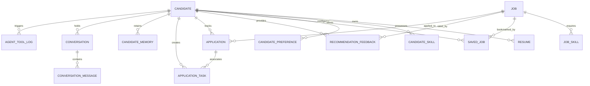

# 🗄️ CareerPilot AI — Database Design & Schema Specification

## 1. Overview

CareerPilot AI uses **SQLite 3** managed via **SQLAlchemy 2.0 ORM**. The database is stored locally at `storage/careerpilot.db`.

The schema is structured into three cohesive functional groups:
1. **Candidate Profile & Resume Domain** (`candidates`, `resumes`, `candidate_skills`, `candidate_preferences`)
2. **Job Catalogue & Opportunity Domain** (`jobs`, `job_skills`, `saved_jobs`, `recommendation_feedbacks`)
3. **Agent, Memory & Application Tracker Domain** (`applications`, `application_tasks`, `candidate_memories`, `conversations`, `conversation_messages`, `agent_tool_logs`)

---

## 2. Entity-Relationship Diagram

---

## 3. Table Schema Definitions

### 3.1 Candidate Profile Domain

#### `candidates`
Stores root candidate identity, contact information, education, and career preferences.

| Column | Type | Constraints | Description |
| :--- | :--- | :--- | :--- |
| `id` | VARCHAR(36) | PRIMARY KEY | Unique candidate UUID |
| `full_name` | VARCHAR(120) | NOT NULL | Candidate full name |
| `email` | VARCHAR(120) | UNIQUE, NOT NULL, INDEX | Primary email address |
| `phone` | VARCHAR(30) | NULLABLE | Phone contact number |
| `education` | VARCHAR(255) | NULLABLE | Institution or degree program |
| `degree` | VARCHAR(100) | NULLABLE | Highest completed degree |
| `experience_years` | FLOAT | DEFAULT 0.0 | Numerical years of professional experience |
| `experience_level` | VARCHAR(50) | DEFAULT 'Internship' | Seniority level (Internship, Entry-Level, etc.) |
| `preferred_roles` | TEXT (JSON) | DEFAULT '[]' | JSON list of target job titles |
| `preferred_locations`| TEXT (JSON) | DEFAULT '[]' | JSON list of desired cities/regions |
| `preferred_work_mode`| VARCHAR(50) | DEFAULT 'Remote' | Remote, Hybrid, On-site, or Any |
| `salary_min_expectation`| INTEGER | NULLABLE | Minimum expected base salary |
| `salary_max_expectation`| INTEGER | NULLABLE | Maximum expected base salary |
| `career_interests` | TEXT (JSON) | DEFAULT '[]' | JSON list of domain interests |
| `created_at` | DATETIME | NOT NULL | Record creation timestamp |
| `updated_at` | DATETIME | NOT NULL | Last modification timestamp |

#### `resumes`
Stores references to raw uploaded resume files and parsed structured outputs.

| Column | Type | Constraints | Description |
| :--- | :--- | :--- | :--- |
| `id` | VARCHAR(36) | PRIMARY KEY | Unique resume UUID |
| `candidate_id` | VARCHAR(36) | FOREIGN KEY (`candidates.id` ON DELETE CASCADE), INDEX | Owning candidate |
| `filename` | VARCHAR(255) | NOT NULL | Original uploaded filename |
| `file_path` | VARCHAR(500) | NOT NULL | Absolute local disk storage path |
| `file_type` | VARCHAR(20) | NOT NULL | Extension (pdf, docx, txt) |
| `raw_text` | TEXT | NULLABLE | Complete extracted raw text |
| `parsed_data` | TEXT (JSON) | DEFAULT '{}' | Structured entities extracted by parser |
| `uploaded_at` | DATETIME | NOT NULL | Upload timestamp |

#### `candidate_skills`
Normalized technical competencies and proficiencies.

| Column | Type | Constraints | Description |
| :--- | :--- | :--- | :--- |
| `id` | INTEGER | PRIMARY KEY, AUTOINCREMENT | Skill record ID |
| `candidate_id` | VARCHAR(36) | FOREIGN KEY (`candidates.id` ON DELETE CASCADE), INDEX | Candidate reference |
| `skill_name` | VARCHAR(100) | NOT NULL, INDEX | Normalized canonical skill name |
| `category` | VARCHAR(50) | DEFAULT 'General' | Programming, AI/ML, Databases, etc. |
| `proficiency` | VARCHAR(30) | DEFAULT 'Intermediate' | Beginner, Intermediate, Advanced, Expert |
| `created_at` | DATETIME | NOT NULL | Skill added timestamp |

---

### 3.2 Job Catalogue Domain

#### `jobs`
Indexed job opportunities with requirements, compensation, and metadata.

| Column | Type | Constraints | Description |
| :--- | :--- | :--- | :--- |
| `id` | VARCHAR(64) | PRIMARY KEY | Unique Job ID (e.g. `job_001`) |
| `company` | VARCHAR(150) | NOT NULL, INDEX | Hiring organization |
| `title` | VARCHAR(150) | NOT NULL, INDEX | Official vacancy title |
| `description` | TEXT | NOT NULL | Detailed job description |
| `role_category` | VARCHAR(80) | NOT NULL, INDEX | Primary domain category |
| `location` | VARCHAR(120) | NOT NULL, INDEX | Geographical location |
| `work_mode` | VARCHAR(50) | NOT NULL, INDEX | Remote, Hybrid, or On-site |
| `employment_type` | VARCHAR(50) | DEFAULT 'Full-time' | Full-time, Part-time, Internship, Contract |
| `experience_level`| VARCHAR(50) | NOT NULL, INDEX | Internship, Entry-Level, Mid-Level, Senior |
| `experience_min_years`| FLOAT | DEFAULT 0.0 | Minimum required years of experience |
| `salary_min` | INTEGER | NULLABLE | Minimum salary |
| `salary_max` | INTEGER | NULLABLE | Maximum salary |
| `application_url` | VARCHAR(500) | NULLABLE | Verified external link |
| `is_active` | BOOLEAN | DEFAULT TRUE | Active posting status |
| `is_sample` | BOOLEAN | DEFAULT TRUE | Synthetic demo record flag |
| `source` | VARCHAR(80) | DEFAULT 'synthetic_catalog' | Data origin reference |
| `created_at` | DATETIME | NOT NULL | Record creation timestamp |
| `updated_at` | DATETIME | NOT NULL | Last update timestamp |

#### `job_skills`
Normalized competencies required or preferred by a job.

| Column | Type | Constraints | Description |
| :--- | :--- | :--- | :--- |
| `id` | INTEGER | PRIMARY KEY, AUTOINCREMENT | Record ID |
| `job_id` | VARCHAR(64) | FOREIGN KEY (`jobs.id` ON DELETE CASCADE), INDEX | Target job reference |
| `skill_name` | VARCHAR(100) | NOT NULL, INDEX | Normalized canonical skill name |
| `is_required` | BOOLEAN | DEFAULT TRUE, INDEX | Hard requirement vs preferred skill |

---

### 3.3 Agent, Memory & Application Tracker Domain

#### `applications`
Tracks individual candidate applications through pipeline stages.

| Column | Type | Constraints | Description |
| :--- | :--- | :--- | :--- |
| `id` | VARCHAR(36) | PRIMARY KEY | Application UUID |
| `candidate_id` | VARCHAR(36) | FOREIGN KEY (`candidates.id` ON DELETE CASCADE), INDEX | Candidate reference |
| `job_id` | VARCHAR(64) | FOREIGN KEY (`jobs.id` ON DELETE CASCADE), INDEX | Associated job |
| `status` | VARCHAR(50) | DEFAULT 'Interested', INDEX | Stage: Saved, Applied, Interview, Offer, Rejected |
| `applied_at` | DATETIME | NULLABLE | Timestamp of submission |
| `notes` | TEXT | NULLABLE | Freeform candidate notes |
| `updated_at` | DATETIME | NOT NULL | Status transition timestamp |

#### `candidate_memories`
Stores extracted facts and persistent conversational preferences.

| Column | Type | Constraints | Description |
| :--- | :--- | :--- | :--- |
| `id` | VARCHAR(36) | PRIMARY KEY | Memory UUID |
| `candidate_id` | VARCHAR(36) | FOREIGN KEY (`candidates.id` ON DELETE CASCADE), INDEX | Candidate reference |
| `memory_key` | VARCHAR(100) | NOT NULL, INDEX | Semantic key (e.g. `preferred_mode`) |
| `memory_value` | TEXT | NOT NULL | Contextual value string |
| `category` | VARCHAR(50) | DEFAULT 'preference', INDEX | preference, goal, constraint |
| `confidence` | FLOAT | DEFAULT 1.0 | Extraction confidence score |
| `created_at` | DATETIME | NOT NULL | Timestamp stored |

#### `agent_tool_logs`
Complete audit log of all tool calls made by the agent.

| Column | Type | Constraints | Description |
| :--- | :--- | :--- | :--- |
| `id` | VARCHAR(36) | PRIMARY KEY | Audit log UUID |
| `candidate_id` | VARCHAR(36) | FOREIGN KEY (`candidates.id` ON DELETE CASCADE), INDEX | Candidate reference |
| `tool_name` | VARCHAR(100) | NOT NULL, INDEX | Name of tool called |
| `arguments` | TEXT (JSON) | NOT NULL | Validated input arguments |
| `result` | TEXT (JSON) | NOT NULL | Structured execution response |
| `execution_time_ms`| FLOAT | NOT NULL | Latency in milliseconds |
| `success` | BOOLEAN | DEFAULT TRUE, INDEX | Success or failure flag |
| `created_at` | DATETIME | NOT NULL | Execution timestamp |
